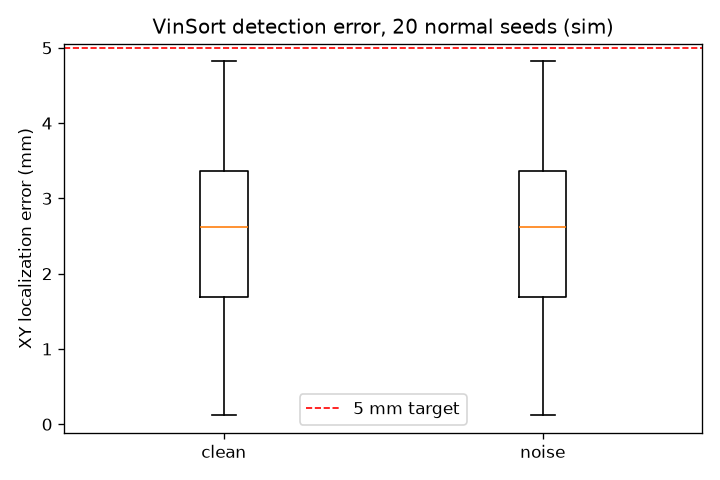

# VinSort: Bằng chứng & Thuyết trình

**Phụ trách D:** Trần Thị Lan · 2A202602621

**Nhóm:** Clauder tập xài Codex · Vin Perception Hackathon, Track 4

**Ngày chạy:** 16/10/2026. Các số dưới đây lấy từ CSV của lần chạy bàn giao.

## 1. Bài toán và người dùng

Người dùng là kỹ thuật viên trạm phân loại linh kiện. Phân loại thủ công có thể nhầm khi vật giống nhau,
trong khi robot cần một cơ chế xử lý vật khó nhận biết. VinSort minh họa cách robot tự xếp vật khi nhận thức
đủ tin cậy và chuyển sang người vận hành khi gặp vùng ảnh nhập nhằng. Bối cảnh ứng dụng đề xuất là
Vin Robotics và khâu phân loại linh kiện VinFast. Nhóm chưa khảo sát hoặc thu thập số liệu tại VinFast.

## 2. Phiên bản và kiến trúc đã kiểm chứng

Bản chạy chính là **`vinsort/`**. Mã ở thư mục gốc là một prototype khác, `teleop.py` còn là stub.
Lệnh `python benchmark.py` ở gốc chuyển tới mã hoàn chỉnh trong `vinsort/`.

```text
Camera ảo RGB + depth
  -> HSV theo màu -> contour -> tâm pixel
  -> nghịch đảo (P x V) với depth -> tọa độ 3D mặt trên
  -> kiểm tra area / aspect / depth / grasp_fail
      -> đủ tin cậy: AUTO -> IK link 11 -> gắp -> thùng đúng màu
      -> nhập nhằng: TELEOP -> người tách vật -> phím a -> AUTO
Webcam thật -> MediaPipe Hands -> 21 landmark -> EMA + giới hạn bước
  -> tọa độ tay / pinch -> TELEOP
```

Mô phỏng PyBullet Franka Panda, 6 khối cạnh 4 cm, 3 màu. Camera ảo 640×480 dùng Tiny Renderer.
Gắp bằng fixed constraint giả lập giác hút. Không dùng YOLO hoặc ArUco trong bản này.
Chuyển AUTO/TELEOP bằng phím `a`/`t` hoặc điều phối khi suspicious. Pinch chỉ điều khiển gắp/thả.
Mất tay giữ vị trí và giữ vật. Giới hạn bước thực tế là 4,5 cm/frame (`STEP_LIMIT=0.045`).

## 3. Phương pháp và số đo

Chạy headless `p.DIRECT`, seed thường 0–19, seed lỗi 100–104. `build_scene` chờ 240 bước cho vật ổn định.
Nhiễu RGB: nhân độ sáng U[0.7, 1.3], cộng Gaussian σ=8/255, seed cố định. Depth giữ nguyên.
Pick có nhiễu đo trên 20 seed thường. Seed lỗi đo pick sạch riêng.

- Recall = số GT được ghép / số GT. Ghép tham lam, cùng màu, gần nhất theo XY, bán kính 20 mm, một đối một.
- FP = phát hiện không ghép được. XY = chuẩn Euclid giữa tọa độ phát hiện và GT, chỉ trên các cặp đã ghép.
- z = z phát hiện − (TABLE_Z + CUBE), kiểm tra mặt trên, không so trực tiếp với tâm vật.
- Đúng thùng = tâm XY của vật nằm trong hình vuông thùng đúng màu ở cuối lượt / mọi vật trong scene.
- Cờ lỗi = số seed lỗi có ít nhất một suspicious. Báo nhầm = tổng suspicious trên seed thường.
- Chu kỳ = tổng bước mô phỏng / 240 / tổng lượt gắp thành công. Bao gồm thời gian thử thất bại nếu có.

| Chỉ số | Sạch | Nhiễu |
|---|---:|---:|
| Recall phát hiện | 120/120 | 120/120 |
| False positive | 0 | 0 |
| XY trung bình / trung vị / max (mm) | 2.55 / 2.63 / 4.82 | 2.55 / 2.63 / 4.82 |
| z trung bình (mm), mặt trên | -0.011 | -0.011 |
| Cờ lỗi đúng (seed lỗi) | 5/5 | 5/5 |
| Cờ báo nhầm (20 seed thường) | 0 | 0 |
| Vật vào đúng thùng (seed thường) | 120/120 | 120/120 |
| Lượt gắp hụt | 0 | 0 |
| Chu kỳ có trọng số (giây mô phỏng/vật) | 4.44 | 4.44 |



Pick sạch ca lỗi: **20/30** vật vào đúng thùng, **10** vật còn lại cần người xử lý.
`skipped_suspicious` trong CSV đếm **blob**, không phải số vật. `remaining_parts` đếm vật GT chưa vào đúng thùng.
Benchmark pick không thực hiện teleop, nên chưa coi các vật còn lại là đã phục hồi.

Capture trung bình 95.0 ms, detect trung bình 5.5 ms trên máy chạy lần này.
Đây là thời gian xử lý camera mô phỏng, không phải độ trễ webcam đến robot. Chưa đo độ chính xác cử chỉ
và độ trễ thao tác người thật. Mỗi cấu hình đo một lượt, chưa có khoảng tin cậy.

CSV thô: `deliverables/results/`. Sai số từng cặp: `xy_pairs*.csv`. Môi trường và hash mã nguồn:
`manifest.json`. Chỉ số để dựng slide: `deliverables/metrics.json`.

## 4. Ca lỗi và bằng chứng phục hồi

Seed 100 đặt hai khối cùng màu sát nhau. HSV tạo một vùng, contour gộp lớn hơn 1,6 × A_REF (1510 px).
Tâm contour có thể nằm giữa hai vật. Hệ thống gắn `suspicious`, lý do `area`, xếp các vật rõ trước,
rồi chuyển TELEOP. Người vận hành tách một vật, nhấn `a`, robot nhìn lại và tiếp tục.

Ảnh RGB, mask và contour ở `deliverables/debug/`. Video có log trạng thái trong `video_events.json`.
Bài kiểm thử `test_full_hybrid_story` dùng tay theo kịch bản để kiểm tra mất tay giữ vật và phục hồi 6/6.
Video dự phòng cũng dùng đầu vào teleop theo kịch bản, ghi rõ trên hình. Đây chưa phải kiểm thử webcam thật.
Đề xuất cải tiến: distance transform + watershed hoặc tách vật dựa trên cạnh depth.

## 5. Trụ cột Track 4

| Trụ cột | Mã và quyết định |
|---|---|
| Hình học | `perception.pixel_to_world`, nghịch đảo P×V và depth, IK trong controller |
| Bất định | suspicious theo hình học blob, chuyển cho người, hai ngưỡng pinch, mất tay giữ vật |
| Bằng chứng | seed cố định, GT engine, CSV, ảnh lỗi, kiểm thử phục hồi |
| Biểu diễn | Detection(color, xyz, suspicious, reason), landmark tay và trạng thái điều phối |
| Thời gian | EMA=0.3, giới hạn bước 0.045 m/frame, sim 240 Hz |

## 6. Impact: kịch bản giả định

| Đại lượng | Giá trị | Căn cứ |
|---|---:|---|
| Tỉ lệ đúng trên khối màu mô phỏng | 120/120 | ĐO trong sim |
| Chu kỳ robot công nghiệp dự kiến | 6 giây/vật | GIẢ ĐỊNH của nhóm, chưa có nguồn thực địa |
| Năng suất lý thuyết | 3600 / 6 = 600 vật/giờ | ƯỚC LƯỢNG từ giả định, chưa trừ dừng máy và can thiệp |
| Sản phẩm đúng/giờ nếu đạt cùng tỉ lệ sim | 600 × 1.00 = 600 | KỊCH BẢN, chưa kiểm chứng sim-to-real |
| Quy mô ca/trạm | 1 ca × 8 giờ × 1 trạm | GIẢ ĐỊNH |
| Giờ vận hành thuộc phạm vi tự động hóa | 8 giờ/ngày | ƯỚC LƯỢNG, chưa phải giờ công thực sự tiết kiệm |

Giờ công tiết kiệm thực = giờ phân loại tay hiện tại − giờ vận hành/giám sát/can thiệp sau triển khai.
Chưa có baseline người thật nên chưa tính ROI hoặc khẳng định giảm lỗi/giảm nhân sự.
Không dùng chu kỳ mô phỏng 4.44 giây làm tốc độ robot công nghiệp.

## 7. Giới hạn và đường sim-to-real

HSV thử trên ba màu bão hòa, vật phẳng, depth lý tưởng. Kết quả sạch và nhiễu tương đương chỉ thể hiện
độ bền trong cấu hình này. Chưa kiểm chứng ánh sáng nhà xưởng, kim loại bóng, vật chồng, camera thật,
ma sát và lực gắp thật. Gắp constraint bỏ qua độ bám. Trạm thật cần đánh giá an toàn và dừng khẩn phần cứng.
Hướng tiếp: dữ liệu vật thật và baseline người, hiệu chuẩn camera K/méo/hand-eye, detector phù hợp,
thử tay gắp thật và đo chu kỳ/can thiệp, sau đó mới pilot.

## 8. Chạy lại và trình bày

```powershell
# Windows dùng WSL Ubuntu vì PyBullet 3.2.7 không có wheel Windows:
powershell -ExecutionPolicy Bypass -File presentation_tools/run_evidence.ps1
```

`run_evidence.ps1` tạo môi trường Linux Python 3.11 riêng, chạy benchmark và test.
Các file `manifest.json`, `environment.txt`, `test_log.txt` ghi môi trường thực đã dùng.
Máy Windows hiện thiếu C++ Build Tools để build PyBullet native, nên chưa kiểm thử GUI/webcam Windows.
Trên máy đã cài đủ thư viện: `python vinsort/main.py --seed 100 --keyboard` chạy demo.
Cử chỉ webcam cần MediaPipe theo `vinsort/requirements.txt` và bỏ `--keyboard`.
Slide và lời dẫn: `deliverables/VinSort_6_slides.pptx`, `deliverables/KICH_BAN.md`.
Video: `deliverables/VinSort_demo.mp4`, có phụ đề đóng sẵn, không có tiếng thuyết minh.
Gói USB: `deliverables/VinSort_D_ban_giao.zip`. Chưa xác nhận sao chép sang USB vật lý.

Webcam chỉ dùng tay thành viên nếu demo trực tiếp. Video bàn giao không thu webcam hoặc dữ liệu cá nhân.
